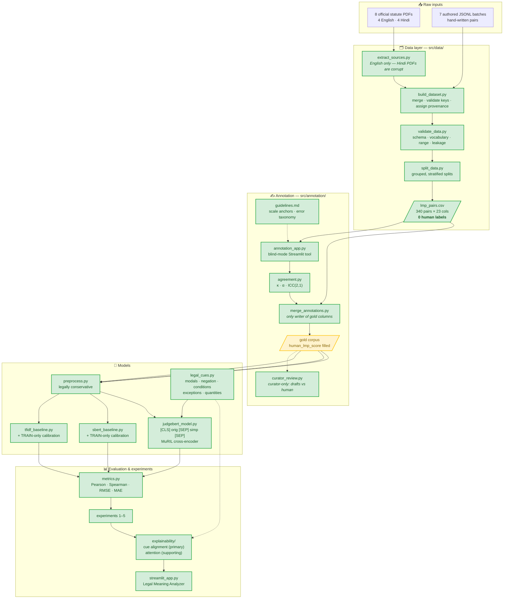

# Explainable Multilingual Legal Meaning Preservation Using JUDGEBERT

**CSET 346 — Natural Language Processing — Semester Project**

An NLP system that predicts whether a simplified or reformulated legal sentence
**preserves the legal meaning** of the original statutory sentence, on a 1–10
Legal Meaning Preservation (LMP) scale, in **English and Hindi**, across three
Indian legal domains — with an explanation of *why*.

Inspired by *JUDGEBERT: Assessing Legal Meaning Preservation Between Sentences*
(Grabar et al.). See [Naming and honesty](#naming-and-honesty) for exactly what
"inspired by" means here.

---

## Research question

> How effectively can a JUDGEBERT-based model assess legal meaning preservation
> in a new language and legal domain, and does it outperform generic
> semantic-similarity approaches?

---

## Project status

This project has completed **human-gold annotation merge, MuRIL cross-encoder training, held-out evaluation, baseline execution, and Experiments 1–5**. There is exactly one rule in force throughout: nothing is reported that was not actually produced.

> [!NOTE]
> **Master Corpus Provenance:** The master corpus was intentionally modified once by the reviewed human-gold merge and remained unchanged afterward. The pre-merge unannotated backup is preserved at `data/processed/lmp_pairs.premerge.20261117T171541Z.csv` (SHA-256: `9F53CC5DEBAA2178C15BD7289EF920DFB8B7399CAAA23A3F30673F54E5385CE5`), while the live post-merge gold corpus has SHA-256: `7327EBC8A519179DA648BE11DD5531D448934760B82850D36B214BC2AA12A216`.

| Phase | Deliverable | Status |
| --- | --- | --- |
| 1 | Project skeleton, config, environment | ✅ complete |
| 2 | Corpus (340 pairs), validation, splitting | ✅ complete |
| 2 | Annotation tool, guidelines, agreement | ✅ complete — **340/340 human gold rows** (320 `human_single`, 20 `human_consensus`) |
| 2 | Test suite | ✅ complete |
| — | **Human LMP annotation & agreement** | ✅ complete — measured on 20 overlapping pairs ($\kappa=0.773$, $\alpha=0.7015$, $\text{ICC}=0.782$) |
| 3 | Baselines (TF-IDF, Sentence-BERT) | ✅ complete — calibrated predictions generated |
| 4 | JUDGEBERT-inspired model | ✅ complete — trained MuRIL cross-encoder checkpoint |
| 5 | Training + evaluation harness | ✅ complete — evaluated on 56 held-out test pairs |
| 6 | Experiments 1–5 execution | ✅ complete — Experiments 1, 2, 3, 4, and 5 executed on human gold |
| 7 | Explainability layer | ✅ complete (auditable cue alignment + supporting attention) |
| 8 | Streamlit demo | ✅ complete (interactive demonstration & cue analyzer) |
| 9 | Paper, presentation, viva bank | ✅ complete (academic report, slide deck, viva bank, checklist) |

### Empirical Test Split Results (56 held-out test pairs)

| Model | Pearson | Spearman | RMSE | MAE | R² | Decision Accuracy | Decision Macro-F1 |
| :--- | :---: | :---: | :---: | :---: | :---: | :---: | :---: |
| **TF-IDF Baseline** (train-calibrated) | 0.491 | 0.411 | 2.261 | 1.843 | 0.162 | 0.446 | 0.429 |
| **SBERT Baseline** (train-calibrated) | 0.285 | 0.302 | 2.426 | 2.053 | 0.034 | 0.375 | 0.384 |
| **JUDGEBERT / MuRIL** (supervised) | 0.468 | 0.409 | 2.728 | 2.089 | -0.221 | **0.607** | **0.528** |

---

## Architecture

Solid arrows are implemented and runnable today. Dotted arrows are planned.



---

## Repository layout

```
NLP_Project/
├── configs/config.yaml          # single source of every setting; nothing hard-coded
├── data/                        # see data/README.md
│   ├── raw/{sources,sections,authored}/
│   ├── processed/lmp_pairs.csv  # THE master corpus
│   │   └── curator_drafts.csv   # CURATOR-ONLY drafts — never shown to annotators
│   └── annotations/             # annotator files + adjudications (no drafts here)
├── src/
│   ├── data/                    # schema, loading, building, splitting, validation
│   │   ├── schema.py            # the single source of truth for the dataset schema
│   │   ├── build_dataset.py     # authored JSONL -> master CSV
│   │   ├── preprocess.py        # deliberately conservative, legally aware
│   │   ├── legal_cues.py        # modals, negation, conditions, quantities, entities
│   │   └── {validate,split,extract}_*.py
│   ├── annotation/              # guidelines.md, annotation_app.py, agreement.py,
│   │                            # merge_annotations.py, curator_review.py (curator-only)
│   └── utils/                   # config, IO with provenance, logging
├── reports/                     # generated + written analyses
│   ├── data_quality.md
│   ├── split_diagnostics.md
│   ├── agreement.md             # RESULT_PENDING until annotators exist
│   ├── curator_draft_review.md  # CURATOR-ONLY: drafts vs human labels
│   └── source_provenance.md     # ← why the Hindi half is author-rendered
├── results/                     # machine-readable outputs, stamped with provenance
└── requirements.txt
```

---

## Quickstart

```bash
# 1. Environment
python3 -m venv .venv
source .venv/bin/activate
pip install -r requirements.txt
pip freeze > requirements.lock.txt      # pin exact versions for the paper

# 2. Rebuild the corpus from the authored batches
python -m src.data.build_dataset         # -> data/processed/lmp_pairs.csv
python -m src.data.validate_data --write-report
python -m src.data.split_data --report

# 3. Annotate (the blocking step — see below)
streamlit run src/annotation/annotation_app.py
```

Expect `validate_data` to report **0 errors and 2 warnings**. Both warnings are
correct and expected while the corpus is unannotated (`gold_coverage`,
`no_human_annotations`); if either disappears before annotation is done,
something has fabricated labels and the build should be investigated.

---

## The corpus at a glance

| Property | Value |
| --- | --- |
| Pairs | **340** = 170 English + 170 Hindi |
| Legal domains | 3 — contract (202), cyber (72), sale_of_goods (66) |
| Source provisions | 159 distinct `source_group`s, each with both languages |
| Splits | 234 train / 50 validation / 56 test |
| Groups spanning splits | **0** (leakage-free by construction) |
| LMP score range | 1–10, all ten values populated |
| Error phenomena | all 11 categories the brief requires, incl. Date/Number/Entity |
| **Human labels** | **340 — completed (320 single, 20 consensus)** |

Full documentation: [`data/README.md`](data/README.md) and
[`data/raw/README.md`](data/raw/README.md).

---

## The integrity rule

The project's central discipline is that **a machine-drafted score is never a
human label**, and the data structure enforces it rather than relying on care:

| Column | Filled by | Rows filled |
| --- | --- | --- |
| `draft_lmp_score`, `draft_error_type` | the corpus author | 340 — *suggestions, not labels* |
| `human_lmp_score`, `error_type`, `decision` | independent human annotators | **340** |

Enforcement is in code, at three layers:

1. **`schema.is_gold()`** — a row is ground truth only if `annotation_status`
   is a `human_*` value *and* it actually carries a score. The second condition
   catches a row marked `human_single` whose score was accidentally cleared.
2. **`load_data.assert_gold()`** — every experiment calls this first, and on the
   current corpus it raises. There are two messages, depending on how the data
   was loaded, and both are correct:

   ```
   >>> assert_gold(load_master(subset="gold"), "Experiment 1")
   ValueError: No rows available for Experiment 1. TODO_HUMAN_ANNOTATION —
   annotate the corpus before evaluating.

   >>> assert_gold(load_master(subset="all"), "Experiment 1")
   ValueError: Refusing to evaluate Experiment 1: 340 row(s) are not
   human-annotated (statuses present: ['draft']). Only ['human_consensus',
   'human_multi_pending', 'human_single'] count as ground truth.
   ```
3. **`build_dataset.assert_no_premature_judgements()`** — the build *refuses to
   write* a master file containing any populated gold column, so a mistake
   upstream cannot ship a contaminated corpus.

Baseline models additionally require an explicit, documented linear calibration
fitted on the **train split only**. Cosine similarity is never reported as an
LMP score — see `configs/config.yaml` → `models.tfidf.calibration`.

---

## Annotation workflow

Annotation is the blocking step. The infrastructure is complete and waiting.

```bash
streamlit run src/annotation/annotation_app.py
```

The tool has three tabs:

* **Annotate** — 1–10 scoring. Strictly **blind**: the curator's draft is never
  rendered, before *or* after a score is saved. There is no reveal control.
  The tool allows a score to be revised, so a draft shown after the first save
  would anchor the revision just as a draft shown before it anchors the
  original — a partially-anchored label is not an independent label. The queue
  offers no draft-based ordering either, since sorting by a hidden field leaks
  it through the position of the pair.
* **Review** — your own progress and your own score distribution, plus the
  corpus-wide agreement coefficients (Cohen's κ quadratic, Krippendorff's α
  ordinal, ICC(2,1), % within ±1 point), or an explicit `RESULT_PENDING`
  explaining why they cannot be computed yet. Per-pair scores from *other*
  annotators are withheld here and appear only in the Adjudicate tab.
* **Adjudicate** — pairs where two annotators differ by ≥2 points. The
  adjudicator must be a different person from both annotators, and the tool
  refuses the record if they are not.

```
annotators score independently  →  agreement.py measures it
        ↓                                    ↓
  <id>.csv per annotator          spread ≥ 2 → adjudication (a third person)
        ↓                                    ↓
        └──────→ merge_annotations.py ←──────┘
                         ↓
        human_single / human_multi_pending / human_consensus
```

Annotations are written to a temporary file and moved into place with
`os.replace`, so an interrupted save cannot destroy the scores already
recorded. Those rows are hand-entered human judgement and cannot be
regenerated; a truncated file would be an afternoon's work lost.

Agreement values are **computed only from annotation files that exist** and are
never estimated, and only from the annotator files — never from the
adjudication file, which would make the coefficient partly a measure of the
adjudicator's own choices. The module returns `RESULT_PENDING` rather than a
number when fewer than 20 pairs have been scored twice, because a coefficient
computed on a handful of rows is noise and reporting it would be worse than
reporting nothing.

The curator's draft scores are compared against the human labels by
`src/annotation/curator_review.py`, which is **curator-only** — it prints the
draft beside the human score for every pair, so showing it to an annotator
would hand them the expected label. It reports `RESULT_PENDING` until human
labels exist.

Read [`src/annotation/guidelines.md`](src/annotation/guidelines.md) before
scoring anything — §2 holds the scale anchors, §4 the error taxonomy, and §7
the confusions that cost the most agreement.

---

## Planned experiments

The Phase 6 experiment harness (`src/experiments/`) is fully implemented and executed on genuine human gold labels. Baseline models and the MuRIL cross-encoder have been benchmarked across all five investigations:

| # | Experiment | Design | Status |
| --- | --- | --- | --- |
| 1 | Baselines vs JUDGEBERT | TF-IDF, SBERT, JUDGEBERT on the test split | ✅ complete (evaluated on human gold) |
| 2 | English vs Hindi | same three models, split by language | ✅ complete (evaluated on human gold) |
| 3 | Generalisation | train on contract + sale_of_goods, test on held-out **cyber** | ✅ complete (evaluated on human gold) |
| 4 | Sanity checks | identical pairs, unrelated pairs, modal/negation/quantity perturbations | ✅ complete (behavioral probes verified) |
| 5 | Qualitative error analysis | ≥15 hard cases across all 11 error phenomena | ✅ complete (evaluated on human gold) |

### Experiment Commands

```bash
# Run all experiments across the human gold corpus
python -m src.experiments.run_all --config configs/config.yaml --output-dir results/experiments

# Run complete dry-run smoke test suite on synthetic fixtures
python -m src.experiments.run_all --config configs/config.yaml --output-dir results/smoke/experiments --smoke-test

# Individual experiment commands
python -m src.experiments.experiment1_baselines --smoke-test --output-dir results/smoke/experiment1
python -m src.experiments.experiment2_language --smoke-test --output-dir results/smoke/experiment2
python -m src.experiments.experiment3_domain_generalization --smoke-test --output-dir results/smoke/experiment3
python -m src.experiments.experiment4_sanity_checks --smoke-test --output-dir results/experiment4
python -m src.experiments.experiment5_error_analysis --smoke-test --output-dir results/smoke/experiment5
```

Held-out-domain generalization: trained using contract and sale_of_goods data, then evaluated across the complete cyber domain, which is absent from training. The complete cyber domain comprises 72 pairs (48 train, 12 validation, and 12 test rows under the standard grouped split; the official corpus test split specifically contains 12 cyber rows). `configs/config.yaml` asserts at load time that `generalization_domain != primary_domain`, ensuring the experiment cannot silently degrade into interpolation, with strictly zero source group overlap between training domains and cyber.

---

## Explainability Layer

Phase 7 implements an auditable, legally salient explainability architecture:

1. **Primary Explanation — Legal Cue Alignment (`src.explainability.cue_alignment`):**
   - Extracts and aligns legally salient elements across original and simplified texts:
     - Modal verbs and deontic force (`STRENGTH_OBLIGATION`, `STRENGTH_PERMISSION`, `STRENGTH_PROHIBITION`, `STRENGTH_RECOMMENDATION`)
     - Negation markers and scope flip
     - Conditional markers (`if`, `unless`, `provided that`, `यदि`, `जब तक`, etc.)
     - Exception clauses (`except`, `save that`, `अन्यथा`, etc.)
     - Numeric values, statutory durations, and dates
     - Legal entity names and structural references (`Section`, `Act`, `Court`, `धारा`, etc.)
     - Universal/existential quantifiers (`all`, `every`, `none`, `प्रत्येक`, etc.)
     - Length and compression ratio
   - Produces structured classifications: `preserved`, `removed`, `added`, `changed`.
   - Generates human-readable, non-dogmatic explanations using calibrated hedge language (e.g., *"Potential obligation mismatch"*, *"Possible negation change"*, *"Quantity differs"*).
   - Generates HTML visualization with highlight spans and strict XSS escaping (`html.escape`).

2. **Supporting Evidence — Attention Attribution (`src.explainability.attention_attribution`):**
   - Extracts last-layer `[CLS]` token attention distribution over `[CLS] orig [SEP] simp [SEP]`.
   - Always provides the mandatory disclaimer:
     > *"Attention weights are not guaranteed to be faithful legal explanations."*
   - Safely degrades when attention weights or models are not loaded (supports deterministic offline mock representations for testing).

### Explainability Commands

```powershell
# 1. Single pair explanation via CLI
.\.venv\Scripts\python.exe -m src.explainability.explanations `
    --original "The contractor shall deliver within 30 days." `
    --simplified "The contractor may deliver within 60 days." `
    --output results\explanations\sample_explanation.json

# 2. Batch dataset explanation
.\.venv\Scripts\python.exe -m src.explainability.explanations `
    --input data\processed\lmp_pairs.csv `
    --output results\explanations\batch_explanations.json
```

---

## Streamlit Demonstration App

Phase 8 implements the interactive web application for legal meaning preservation demonstration and diagnostic evaluation:

```powershell
.\.venv\Scripts\python.exe -m streamlit run src\app\streamlit_app.py
```

### Application Features & Safeguards

- **Strict Integrity Guard:** Displays the `⚠️ Human Annotation Pending` badge prominently. Never reveals or implies curator draft scores or synthetic outputs as human ground truth.
- **Bilingual Legal Input:** Supports English and Hindi sentence pairs with Unicode preservation and non-empty/length validation.
- **Curated Corpus Exploration:** Allows loading authentic statutory pairs from `data/processed/lmp_pairs.csv` without exposing draft labels or expected answers.
- **Graceful Checkpoint Handling:** If no trained cross-encoder weights exist (expected prior to human annotation), clearly alerts the user:
  > *"JUDGEBERT checkpoint unavailable. Train a valid checkpoint after human annotation is available."*
  and continues providing the full auditable legal cue comparison.
- **Primary Auditable Cue Alignment:** Highlights modals, negations, conditions, exceptions, quantities, dates, entities, and quantifiers with HTML span highlighting and calibrated hedge summaries.
- **Supporting Attention Attribution:** Presents token attention when available, accompanied by the mandatory disclaimer:
  > *"Attention weights are not guaranteed to be faithful legal explanations. They are reported as weak supporting evidence only, and are never presented as a legal justification."*
- **Provenance & Limitations:** Clearly stamps model identities, configuration fingerprints, seed, timestamp, and the Hindi provenance limitation.

---

## Reproducibility

Every artefact in `results/` carries a provenance header: UTC timestamp, git
revision, Python version, platform, config fingerprint and seed. The config
fingerprint is a SHA-256 of the config with machine-specific absolute paths
stripped, so two machines running the same experiment produce the same
fingerprint.

A single seed in `configs/config.yaml` (`project.seed`) drives splitting,
sampling and training. `set_global_seed()` additionally pins
`torch.use_deterministic_algorithms` where available.

This project directory is its own git repository. Until it has a first commit,
`git_revision()` reports `"unknown"` rather than borrowing a revision from some
other repository — a provenance field that names the wrong commit is worse than
one that admits it does not know. Commit once and every subsequent results file
stamps the real hash.

```bash
python -m src.data.build_dataset      # deterministic
python -m src.data.split_data --report # deterministic; re-running is a no-op
python -m src.annotation.agreement --report
python -m src.annotation.merge_annotations   # dry run by default
python -m src.annotation.curator_review      # CURATOR-ONLY; never run for an annotator
```

`merge_annotations` writes in place and is therefore destructive, so it prints
a full change summary and **writes nothing without `--apply`**. Use
`--apply --backup` to keep a timestamped copy of the pre-merge master.

Cite `requirements.lock.txt`, not `requirements.txt`, in the paper — only the
lock file pins exact versions.

### Hardware

Developed on Apple Silicon (macOS, MPS backend). `torch` installs the
MPS-enabled build automatically. For CUDA, install torch from the appropriate
wheel index first, then the rest of `requirements.txt`. No GPU is required to
run the data layer, the annotation tool, or the baselines.

---

## Testing

```bash
.venv/bin/python -m pytest tests/ -q      # 974 tests, ~1m, no GPU, no network
```

No test downloads a model, calls an API, or needs a GPU, so the suite runs completely offline and can gate every commit.

| Module | Tests | Covers |
| --- | --- | --- |
| `test_schema.py` | 36 | column contract, dtype coercion, the gold gate, CSV round-trip |
| `test_load_data.py` | 27 | loading, derived columns, `assert_gold` refusal messages |
| `test_split_data.py` | 18 | group integrity, reproducibility, stratification |
| `test_preprocess.py` | 39 | normalisation, Devanagari tokenisation, the legal-content guard |
| `test_legal_cues.py` | 67 | modals, negation, conditions, exceptions, quantities |
| `test_agreement.py` | 48 | κ / α / ICC(2,1) against known-answer cases, the `RESULT_PENDING` gate |
| `test_annotation_merge.py` | 27 | status assignment, adjudication precedence, error-type conflicts |
| `test_annotation_app.py` | 63 | blind-mode guarantee, score range, atomic saves, queue walk, adjudicator independence |
| `test_explainability.py` | 18 | cue alignment, modal shift, negation, quantity, XSS safety, CLI |
| `test_attention_attribution.py` | 5 | attention attribution, mandatory disclaimer, fallback safety |
| `test_app_ui_helpers.py` | 20 | UI input validation, Unicode preservation, sample loading integrity |
| `test_app_model_registry.py` | 14 | model availability, missing checkpoint detection, mock prediction |
| `test_streamlit_app.py` | 11 | AppTest rendering, warning badge, disclaimer, no draft leakage |

Three habits are deliberate:

* **Known-answer cases.** The agreement coefficients are checked against
  hand-computed values (perfect agreement → 1.0, systematic opposition → κ = 0.0,
  zero variance → undefined), not merely against their own previous output.
* **Regression tests are named after the bug.** Each one states the symptom and
  why it mattered, so the test explains itself to whoever trips it. The
  tokenisation and quantity regressions in `test_preprocess.py` and
  `test_legal_cues.py` are the two worth reading.
* **The workflow tests are mutation-checked.** A test that passes the first
  time deserves suspicion, so the annotation tests were re-run against a
  deliberately broken app — the queue cursor reverted to its skipping version,
  and a post-save draft reveal reinstated. Both break the suite. That check
  caught a weak assertion of my own: an end-to-end test asserting the queue was
  *ascending* passed happily while every other pair was being skipped, because
  a skipping queue is still ascending. It now asserts the exact pairs the
  default queue must present.

A test that asserts a guarantee the code does not actually make is worse than
no test, so several tests here also pin behaviour that looks like a defect and
is not — cross-category cue overlap, and trusting a file's declared
`annotator_id` over its filename are both load-bearing (see the docstrings).

---

## Known limitations

Stated here rather than buried, because each one constrains what the paper can
claim.

1. **The Hindi half is author-rendered, not quoted.** Every official Hindi
   statute PDF obtained uses a legacy non-Unicode font whose glyph mapping is
   broken; the Hindi word for "Act" appears zero times in a 41-page Hindi Act.
   All 170 Hindi rows carry `verbatim_quote: "false"`. The two language halves
   are therefore **not equivalent provenance categories**, so Experiment 2
   mixes a language effect with a provenance effect. Full evidence:
   [`reports/source_provenance.md`](reports/source_provenance.md).
2. **The corpus is small** (340 pairs), which is why splits are grouped by
   `source_group` to prevent sibling leakage, and why bootstrap confidence
   intervals are reported alongside every metric.
3. **Human gold corpus scale.** The corpus has 340 human gold rows (320 single, 20 consensus). While sufficient for benchmark evaluation and cross-encoder fine-tuning, wider multi-annotator coverage remains a valuable direction for future expansion.
4. **"JUDGEBERT-inspired" is a deliberate hedge.** The original work's exact
   architecture and training recipe are not fully specified in the public
   paper, so this project implements a cross-encoder regression model in the
   same spirit and does not claim to reproduce it. See below.

### Naming and honesty

* The model is **JUDGEBERT-*inspired***, not a reproduction.
* **Attention weights are not a legal explanation.** The explainability layer
  leads with auditable cue alignment, and reports attention as weak supporting
  evidence only, with an explicit disclaimer in the UI.
* **No fabricated numbers.** Every metric in the paper must come from an actual
  run. Placeholders `TODO_RUN_EXPERIMENT`, `TODO_HUMAN_ANNOTATION` and
  `RESULT_PENDING` mark the gaps rather than papering over them.
* **Agreement values are measured, never asserted.**
* **No paid external API** is required anywhere in the pipeline.

---

## Documentation index

| Document | What it covers |
| --- | --- |
| [`reports/academic_report.md`](reports/academic_report.md) | Final academic research report & methodology paper draft |
| [`reports/presentation_outline.md`](reports/presentation_outline.md) | 15-slide technical presentation deck specification |
| [`reports/viva_question_bank.md`](reports/viva_question_bank.md) | 55-question viva voce defense preparation bank |
| [`reports/reproducibility_checklist.md`](reports/reproducibility_checklist.md) | Reproducibility & scientific integrity verification checklist |
| [`src/annotation/guidelines.md`](src/annotation/guidelines.md) | The annotation procedure, scale anchors, error taxonomy, agreement protocol |
| [`data/README.md`](data/README.md) | Schema, integrity property, annotation workflow, rebuild instructions |
| [`data/raw/README.md`](data/raw/README.md) | Source documents, authored batch format, deliberate corpus design |
| [`reports/source_provenance.md`](reports/source_provenance.md) | Source provenance and the Hindi PDF corruption evidence |
| [`reports/data_quality.md`](reports/data_quality.md) | Latest validation output |
| [`reports/split_diagnostics.md`](reports/split_diagnostics.md) | Split balance and leakage checks |
| [`reports/agreement.md`](reports/agreement.md) | Inter-annotator agreement (currently `RESULT_PENDING`) |
| [`reports/engineering_status.md`](reports/engineering_status.md) | Complete engineering and delivery status across all phases |

---

## Licence

Source statute texts are Government of India works, not subject to copyright
under s.52(1)(q) of the Indian Copyright Act, 1957. See [`LICENSE`](LICENSE)
for the terms covering this repository's own code and data.
